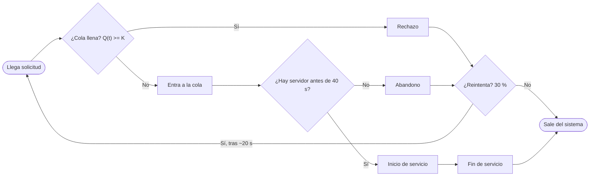
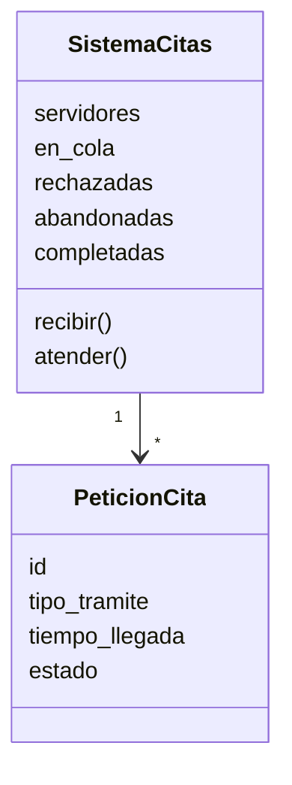
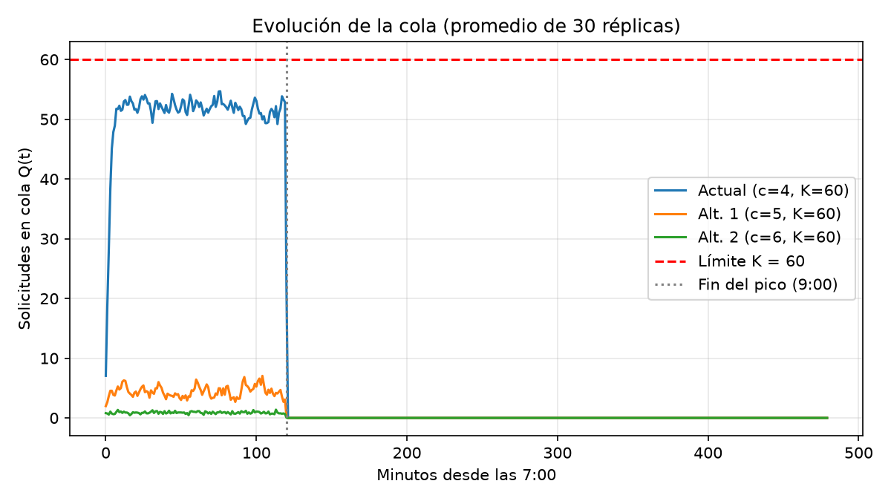
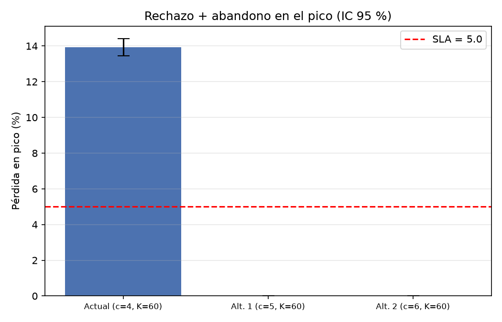
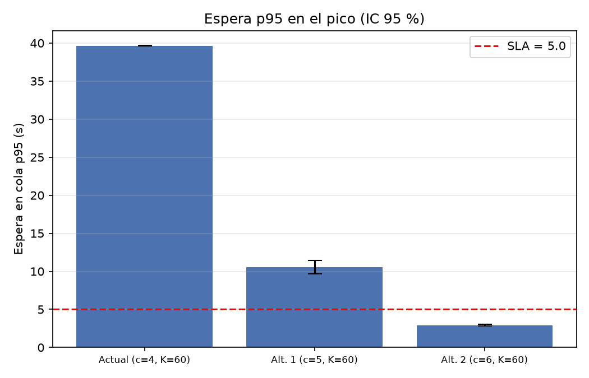
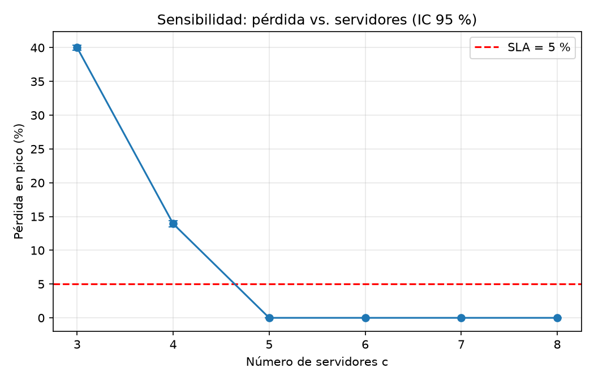

# Informe Final — Sistema de agendamiento de citas médicas vía API

- **Curso:** Modelos y Simulación (2026-2) — I.U. Pascual Bravo
- **Grupo:** Grupo 5
- **Repositorio:** https://github.com/CarlRM883/Proyecto-aula-CitasMedicas
- **Comando de despliegue API:** `docker compose up --build -d`
- **Comando de ejecución SimPy:** `python simulacion/main.py`

| Integrante | Correo Institucional | Rol Ejecutado | Commits Principales (Módulos) |
| :--- | :--- | :--- | :--- |
| Mateo Ossa Restrepo | mateo.ossa289@pascualbravo.edu.co | Modelado DES / SimPy | `simulacion/` |
| Carlos Andres Ramirez Mejia | carlos.ramirez883@pascualbravo.edu.co | Infraestructura / API / Telemetría | `sistema_real/`, `docker-compose.yml` |
| Valentina Alvarez Zea | valentina.alvarez484@pascualbravo.edu.co | Análisis Estadístico / Contraste M/M/c | `analisis/`, `docs/` |

---

## 1. Resumen Ejecutivo

La API de citas tiene 4 servidores y una sala de espera (cola) para 60 solicitudes. En el pico de la mañana (7:00–9:00) llegan 5.400 solicitudes por hora, pero los servidores solo pueden atender 4.800 por hora. Por eso el sistema se llena y pierde solicitudes. Con una simulación (SimPy, 30 repeticiones) probamos 3 opciones: 4, 5 y 6 servidores. Con 4 servidores (lo actual) se pierde el **13,9 %** de las solicitudes en el pico. La única opción que cumple todos los umbrales de calidad (SLA) es **6 servidores**: 0 % de pérdida, espera p95 de 2,9 s y uso de servidores del 75 %. Agrandar solo la cola no soluciona el problema.

## 2. Contexto del Sistema y Subsanación de la Entrega 1

### 2.1 Dinámica del Sistema (Qué fluye, qué espera, qué se satura)

- **Qué fluye (entidad):** la *solicitud* de un paciente. Puede ser AGENDAR (60 %), REPROGRAMAR (25 %) o CANCELAR (15 %). El tipo de trámite es una característica (atributo) de la solicitud, no un recurso.
- **Qué lo atiende (recurso):** los *servidores*, c = 4 hoy.
- **Dónde espera:** en la *cola*, que es solo la sala de espera de los servidores (no es un recurso). Es FIFO (el primero que llega es el primero atendido) y cabe K = 60.
- **Qué cambia en el tiempo (variables de estado):** Q(t) = solicitudes en cola, B(t) = servidores ocupados, y los contadores de rechazadas, abandonadas y completadas.
- **Qué eventos ocurren:** llegada, inicio de servicio, fin de servicio y rechazo.
- **Qué se satura (límite duro, C6):** los servidores. Capacidad máxima = 4 servidores × (1/3 solicitud por segundo) = 4.800 solicitudes/hora. Además, si la cola ya tiene 60, la solicitud nueva se rechaza.
- **Comportamiento del paciente (C7):** si espera más de 40 s, se va (abandono). Después de un rechazo o abandono, el 30 % lo intenta una vez más ~20 s después.
- **Qué decidimos:** cuántos servidores (c) y qué tamaño de cola (K). No usamos "sobrecupo", porque nuestro modelo mide peticiones HTTP rechazadas, no cupos de agenda.
- **Unidad de tiempo:** segundos.

**Figura 1.** Flujo de una solicitud.

**Figura 2.** Clases principales del código.

### 2.2 Tabla de Subsanación de la Entrega Parcial 1

| Observación / Error en Entrega 1 | Corrección Implementada | Archivo |
| :--- | :--- | :--- |
| Se hablaba de "alto rechazo" pero la simulación daba 0 % | Pico subido a 1,5 solicitudes/s (5.400/h): ahora sí hay congestión | `simulacion/config.py` |
| Tipo de trámite y cola estaban como recursos | Recurso = servidores; cola = sala de espera; tipo = atributo | `simulacion/modelo_simpy.py` |
| Faltaban variables de estado y eventos | Se definieron Q(t), B(t), contadores y eventos | `simulacion/modelo_simpy.py` |
| Diagramas fuera del documento | Figuras 1 y 2 dentro del informe | este archivo |
| Erlang C del valle estaba mal (0,0028) | Corregido a 0,0035; capacidad máxima 4.800/h | `analisis/contraste_mmc.py` |
| Contraste M/M/c solo con texto | Tabla con números, error relativo y Ley de Little | `analisis/contraste_mmc.py` |
| Una sola corrida, sin semillas ni p95 | 30 repeticiones, semillas 42–71, p95/p99 e IC 95 % | `simulacion/main.py` |
| Utilización calculada con fórmula | Utilización medida dentro de la simulación | `simulacion/modelo_simpy.py` |
| Servicio sin dos parámetros; "datos históricos" inexistentes | Distribución lognormal con media y CV; fuente eliminada | `simulacion/config.py` |
| API sin persistencia ni telemetría | Base SQLite + archivo `telemetry_log.csv` + prueba con Locust | `sistema_real/main.py` |

### 2.3 Glosario rápido

- **λ:** solicitudes que llegan por segundo. **μ:** solicitudes que un servidor atiende por segundo (1/3).
- **ρ (utilización):** λ / (c·μ). Si ρ ≥ 1, la cola crece sin control.
- **M/M/c:** fórmula de teoría de colas para c servidores con cola infinita.
- **Lq, Wq, W:** solicitudes en cola, espera en cola y tiempo total en el sistema.
- **Ley de Little:** L = λ·W. Sirve para comprobar que la simulación está bien.
- **SLA:** umbral de calidad que queremos cumplir. **p95:** el 95 % de las solicitudes espera ese tiempo o menos.
- **IC 95 %:** rango donde está la media real con 95 % de confianza. **Réplica:** una corrida completa con otra semilla.

## 3. Arquitectura del Prototipo, Telemetría y Parámetros Calibrados

### 3.1 Resumen de Telemetría del Sistema Real Contenerizado

La API (FastAPI) corre en Docker, guarda cada trámite en SQLite (`datos/citas.db`) y anota en `datos/telemetry_log.csv` la latencia, CPU y RAM de cada petición. La carga se generó con **Locust** (50 usuarios, 60 s, mezcla 60/25/15).

### 3.1 Resumen de Telemetría del Sistema Real Contenerizado

La API (FastAPI) corre en Docker, guarda cada trámite en SQLite (`datos/citas.db`) y anota en `datos/telemetry_log.csv` la latencia, CPU y RAM de cada petición. La carga se generó con **Locust** (50 usuarios, 60 s, mezcla 60/25/15).

| Trámite | n | Latencia media (ms) | p95 (ms) | p99 (ms) |
| :--- | :---: | :---: | :---: | :---: |
| AGENDAR | 1542 | 890,82 | 1000,02 | 1048,18 |
| REPROGRAMAR | 653 | 898,66 | 1001,46 | 1046,26 |
| CANCELAR | 397 | 887,97 | 995,61 | 1042,65 |
| **TODOS** | **2593** | **892,36** | **1000,54** | **1046,42** |

CPU máxima: 6,2 %. RAM máxima: 66,3 MB. Rendimiento de Locust: ≈ 43 req/s en promedio (2593 peticiones en 60 s).

**Importante:** la API local responde en ~0,9 s en promedio (p95 ≈ 1,0 s) con 50 usuarios concurrentes, y la latencia es casi igual para los tres trámites. Se ajusta a una lognormal con μ = −0,130 y σ = 0,224 (CV ≈ 0,23). Esto es menor que los 3 s del modelo, que son un **supuesto**: representan una API real con base de datos remota bajo carga. La telemetría mide el comportamiento de nuestro prototipo, no el de producción.

### 3.2 Parámetros y Distribuciones de Entrada del Modelo SimPy

| Parámetro | Proceso | Distribución y parámetros | Unidad | Fuente |
| :--- | :--- | :--- | :--- | :--- |
| Llegadas en pico (7–9 h) | Entrada | Poisson no homogénea, λ = 1,5 | sol/s | Supuesto de estrés |
| Llegadas en valle (9–15 h) | Entrada | Poisson no homogénea, λ = 0,2 | sol/s | Supuesto |
| Mezcla de trámites | Entrada | 60 % / 25 % / 15 % | — | Supuesto |
| Servicio AGENDAR | Servidor | Lognormal, media 3,5 s, CV 0,5 | s | Supuesto (ver 3.1) |
| Servicio REPROGRAMAR | Servidor | Lognormal, media 3,0 s, CV 0,5 | s | Supuesto |
| Servicio CANCELAR | Servidor | Lognormal, media 1,0 s, CV 0,5 | s | Supuesto |
| Servidores / Cola | Recurso | c = 4, K = 60 (actual) | — | Arquitectura actual |
| Paciencia | Cola | 40 s | s | Supuesto (timeout del cliente) |
| Reintento | Paciente | 30 %, ~20 s después, máx. 1 vez | — | Supuesto |

El servicio promedio es 0,6·3,5 + 0,25·3,0 + 0,15·1,0 = 3,0 s, así que μ = 1/3 por servidor.

## 4. Diseño Experimental y Contraste Analítico (M/M/c vs. SimPy)

- **Horizonte:** 8 horas = 28.800 s, empezando con el sistema vacío.
- **Calentamiento (warm-up):** 0 s en las políticas (queremos ver la jornada completa desde cero). En la validación M/M/c: 30 min de calentamiento sobre 3 h.
- **Réplicas:** 30, con semillas 42 a 71 (las mismas para todas las políticas).

### 4.1 Tabla de Validación Analítica (Régimen Estacionario Exponencial)

SimPy en modo "teórico" (servicio exponencial, llegadas constantes λ = 1,0/s, cola infinita, sin abandono ni reintento). ρ = 0,75.

| Métrica | M/M/4 analítico | SimPy (Media ± IC 95 %) | Diferencia relativa (%) |
| :--- | :---: | :---: | :---: |
| Utilización (ρ) | 0,7500 | 0,7482 ± 0,0041 | −0,2 |
| Cola media (Lq) | 1,5283 | 1,4995 ± 0,0722 | −1,9 |
| Espera en cola (Wq, s) | 1,5283 | 1,5012 ± 0,0691 | −1,8 |
| Tiempo en el sistema (W, s) | 4,5283 | 4,5020 ± 0,0758 | −0,6 |

En el valle (λ = 0,2), la probabilidad de esperar es **0,0035** y W = 3,0031 s (analítico) contra 2,9965 ± 0,0244 s (SimPy). **Ley de Little:** L = 4,492 ± 0,086 y λ·W = 4,491 ± 0,085, o sea que la simulación es coherente.

**¿Por qué M/M/c no alcanza?** Si activamos las reglas reales (servicio lognormal por trámite), la espera baja a 1,06 s, un 31 % menos que la fórmula. Además, en el pico real ρ = 1,125 (mayor que 1), y ahí **la fórmula M/M/4 no existe**: la cola se llena y aparecen rechazos y abandonos (13,9 %). La fórmula asume cola infinita y no puede predecir eso.

## 5. Resultados de la Simulación y Evaluación de Políticas de Decisión

### 5.1 Comparación Cuantitativa de Escenarios

Pico 7:00–9:00, media ± IC 95 % de 30 réplicas.

| KPI (con unidad) | Umbral SLA | Actual (c=4, K=60) | Alternativa 1 (c=5, K=60) | Alternativa 2 (c=6, K=60) |
| :--- | :---: | :---: | :---: | :---: |
| Espera en cola p95 (s) | ≤ 5,0 | 39,65 ± 0,01 ✗ | 10,54 ± 0,86 ✗ | 2,92 ± 0,12 ✓ |
| Espera en cola p99 (s) | — | 39,93 ± 0,00 | 15,61 ± 1,54 | 5,15 ± 0,30 |
| Rechazo por cola llena (%) | — | 7,01 ± 0,37 | 0,00 | 0,00 |
| Abandono (%) | — | 6,91 ± 0,15 | 0,00 | 0,00 |
| Pérdida total: rechazo + abandono (%) | ≤ 5,0 | 13,93 ± 0,47 ✗ | 0,00 ✓ | 0,00 ✓ |
| Utilización de servidores (%) | 70–85 | 99,92 ± 0,02 ✗ | 89,60 ± 0,40 ✗ | 74,84 ± 0,31 ✓ |
| Cola al cierre (solicitudes) | < 5 | 0 ✓ | 0 ✓ | 0 ✓ |
| **¿Cumple SLA?** | | **No** | **No** | **Sí** |

**Figura 3.** Cola Q(t) promedio durante la jornada.

**Figura 4.** Pérdida en el pico (línea roja = SLA).

**Figura 5.** Espera p95 en el pico (línea roja = SLA).

**Figura 6.** Pérdida según el número de servidores.

### 5.2 Análisis de las Preguntas de Decisión

- **¿Cuántos servidores hacen falta?** Con 4, la demanda (5.400/h) supera la capacidad (4.800/h): la cola vive casi llena (~52, Figura 3) y se pierde el 13,9 %. Con 5 ya no hay pérdida, pero la espera p95 es 10,5 s y el uso es 89,6 %: no cumple. Con **6** todo cumple. Con 7 u 8 también cumple, pero el uso baja a 64 % y 56 % (capacidad desperdiciada, Figura 6).
- **¿Agrandar la cola ayuda?** No. Con 4 servidores, K = 30 pierde 14,1 %, K = 60 pierde 13,9 % y K = 120 o 240 pierde 14,4 %. La cola grande solo cambia los *rechazos* por *abandonos*: la gente espera 40 s y se va. El cuello de botella son los servidores.
- **¿Cuánta cola queda al cierre?** Ninguna. En el valle los servidores sobran (ρ = 0,15) y la cola se vacía apenas termina el pico.

## 6. Recomendación de Ingeniería y Declaración de Uso de IA

### 6.1 Recomendación Técnica Final

Usar **6 servidores con cola de 60**. Es la única opción que cumple los tres umbrales en el pico (pérdida 0 %, espera p95 2,9 s, uso 75 %). Cuesta 2 servidores más. Como en el valle bastan 4, lo ideal es **subir a 6 solo de 7:00 a 9:00**. Si solo se pueden poner 5, se elimina la pérdida pero la espera (10,5 s) incumple el SLA. **Limitación:** los tiempos de servicio y la mezcla de trámites son supuestos; hay que recalibrarlos con datos de producción antes de decidir.

**Fuentes técnicas:** Law, A. M. (2015). *Simulation Modeling and Analysis* (5.ª ed.), McGraw-Hill (réplicas e intervalos de confianza). Harchol-Balter, M. (2013). *Performance Modeling and Design of Computer Systems*, Cambridge University Press (M/M/c y Erlang C). Little, J. D. C. (1961). A proof for the queuing formula L = λW. *Operations Research, 9*(3), 383–387. Documentación de SimPy (simpy.readthedocs.io) y de Locust (docs.locust.io).

### 6.2 Declaración de Uso de Inteligencia Artificial

| Herramienta de IA | Dónde se utilizó | Qué verificó, corrigió y validó el equipo |
| :--- | :--- | :--- |
| Claude | Clases POO, modelo SimPy, API, Locust, análisis e informe | Revisión de cada línea; cálculo manual de Erlang C; comprobación con Ley de Little; ejecución de todas las corridas |
| ChatGPT | Cálculo M/M/c preliminar (E1) | Recalculado a mano; se corrigió el Pw del valle (0,0035) |
| Gemini | Tabla de parámetros, métricas y riesgos (E1) | Contrastado con las observaciones del docente |
